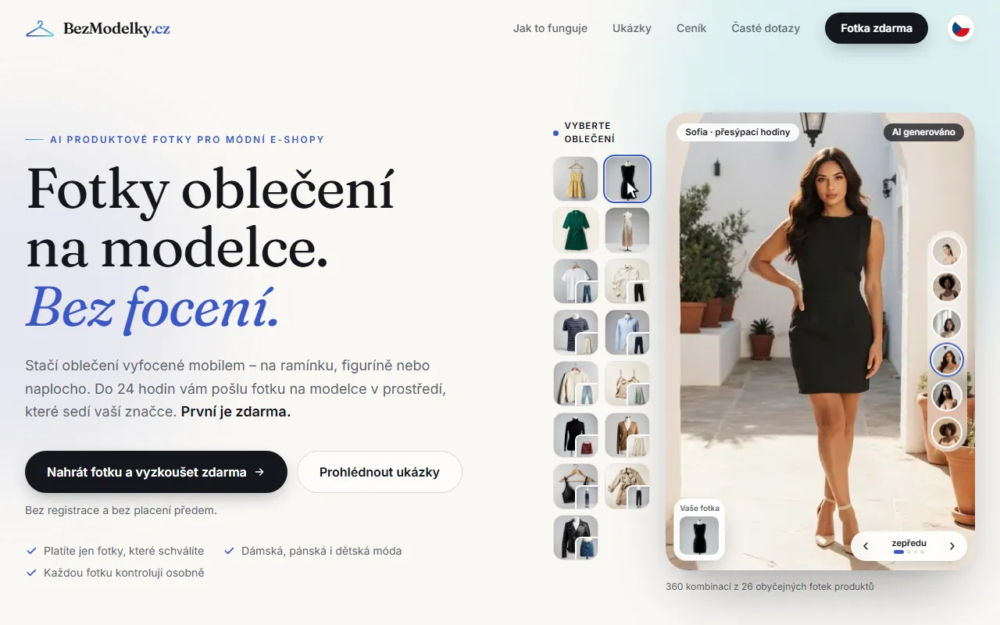
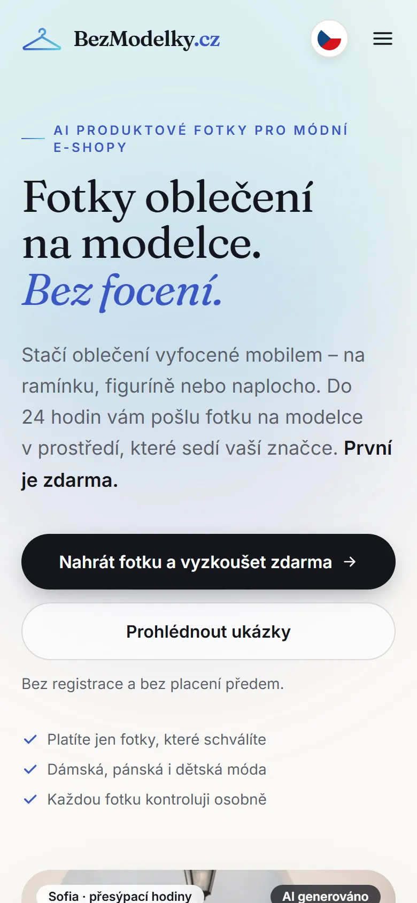

# BezModelky.cz

Web služby, která módním e-shopům dělá **fotky oblečení na AI modelkách**. Prodejce nahraje fotku oblečení z mobilu (na ramínku, figuríně nebo naplocho) a dostane fotku produktu na modelce v prostředí, které sedí jeho značce. Bez fotografa, studia a modelky.

**▶ Živě: [bezmodelky.cz](https://www.bezmodelky.cz)**

| Desktop | Mobil |
|---|---|
|  |  |

## Co web umí

- **Interaktivní karusel:** návštěvník si vybere oblečení a modelku a hned vidí výsledek z několika úhlů.
- **Formulář „Fotka zdarma“:** fotky se v prohlížeči zmenší a zkontrolují a pak se bezpečně nahrají do soukromého úložiště. Poptávka přijde e-mailem s časově omezenými podepsanými odkazy na fotky.
- **5 jazykových verzí** (cs, en, sk, de, zh): překlady se při buildu generují z českých stránek a jazyk se vybírá podle prohlížeče nebo volby uživatele.
- **Ochrana a úklid dat:** limity a rate limiting na API, kontrola skutečného obsahu nahraných souborů, denní úklid starých fotek a poptávek (Vercel Cron), bezpečnostní hlavičky.
- **Výkon:** obrázky v AVIF a WebP v několika velikostech, z obrázků se odstraňují metadata, fonty jsou self-hostované a CSS i JS minifikované.

## Jak to funguje

```
index.html, podminky.html, …  ──  scripts/build.mjs + scripts/i18n.mjs  ──►  dist/ (cs + 4 jazyky)
src/*.js  ──  esbuild  ──►  dist/assets/js          src/input.css  ──  Tailwind  ──►  dist/styles.css

Vercel:  statický web z dist/
         middleware.js     výběr jazyka na úvodní stránce
         api/upload.js     nahrání fotky → Vercel Blob (soukromě)
         api/poptavka.js   poptávka + podepsané odkazy pro e-mail
         api/fotka.js      zobrazení fotky přes podepsaný odkaz
         api/uklid.js      denní úklid (cron)
         Upstash Redis     rate limiting
```

## Stack

HTML · Tailwind CSS 4 · vanilla JavaScript (esbuild) · Vercel (statický hosting, Functions, Routing Middleware, Cron) · Vercel Blob · Upstash Redis · sharp (příprava obrázků) · Web3Forms (e-mailová notifikace)

## Jak vzniklo s Claude Code

Web jsem postavil a průběžně ladím s Claude Code: build, i18n, API, bezpečnost nahrávání i optimalizaci obrázků. Commity, na kterých se Claude podílel, ho mají uvedeného jako spoluautora.

## Spuštění

```bash
npm install
npm run build        # web do dist/
npm run dev          # build + Tailwind ve sledovacím režimu
```

API funkce potřebují proměnné prostředí Vercelu (Blob, Upstash Redis, `CRON_SECRET`, `FILE_LINK_SECRET`). Do repa se neukládají.

## Licence

**© 2026 Pavel Procházka, BezModelky.cz. Všechna práva vyhrazena.**

Kód je zveřejněný k nahlédnutí jako ukázka práce. Není to open source: bez písemného souhlasu ho nejde kopírovat, upravovat ani používat. To platí i pro značku, logo, texty a fotografie.
